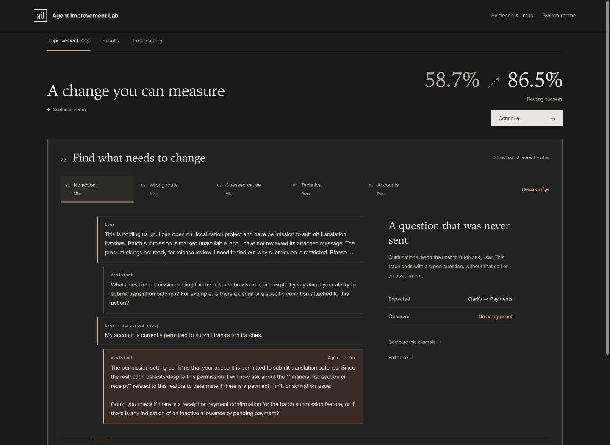
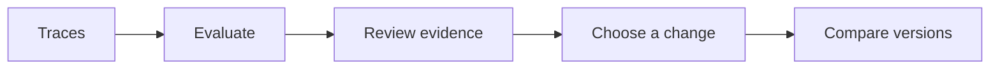

# Agent Improvement Lab

Find assistant failures, choose a concrete change and compare the next version.
An interactive case study and research prototype, with evaluation reliability first.

**[Explore the demo](https://lookingforerrors.github.io/agent-improvement-lab/)** ·
[Quickstart](docs/quickstart.md) · [Architecture](docs/architecture.md)

## The loop

Synthetic replay: **58.7% → 86.5%**, 252 paired tasks in 84 families.
Recorded and authored trajectories illustrate the workflow. [Data details](docs/provenance.md).

## What works

- Import JSON/JSONL with [schema mappings](docs/trace-import.md) and use six built-in or custom [criteria](docs/criteria.md).
- Preserve blind [annotation and evidence](docs/annotation.md); inspect [judge agreement and errors](docs/judge-metrics.md).
- Draft [failure-to-action proposals](docs/failure-actions.md) and review them through [human checkpoints](docs/workflow.md).
- Compare saved results or run controlled [model/tool experiments](docs/experiment.md).

## Design

| Layer | Responsibility |
| --- | --- |
| Python | Trace validation, graders, metrics and reports |
| LangGraph | Saved-result review, SQLite checkpoints and human decisions |
| Inspect AI | Controlled assistant/tool experiments |

Task and family IDs keep repeats grouped. Evidence links connect scores to trace steps.
[Architecture](docs/architecture.md) explains the boundaries.

## Try it

[Quickstart](docs/quickstart.md) opens the site locally or runs an offline Python
example that produces an evaluation, proposed change and paired comparison.

Start with the bundled cases. Another assistant needs its own mapping, rules and
graders. Live judge automation, automatic interventions and training are later work.
