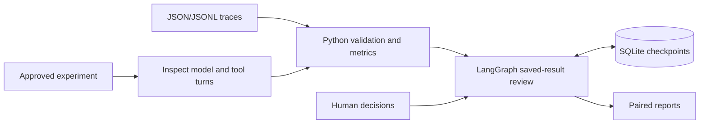

# Architecture

Measurement, saved-result review and controlled execution have separate responsibilities.

**Python** normalizes traces, runs versioned graders, aggregates metrics and links
findings to evidence. Task and family IDs keep repeats grouped; missing and
unassessable outcomes remain visible.

**LangGraph** resumes the saved-result workflow at annotation, plan and approval
checkpoints. Comparisons read supplied trajectories and assessments. Review does
not apply a change or call a model.

**Inspect AI** handles assistant/tool turns in controlled experiments. Python
seals the experiment configuration, checks approval, enforces budgets and writes
reports. Tools affect simulated tickets; models use a caller-managed endpoint.

An action can inform a separately approved experiment. Results support the next
human decision; they never automatically promote a candidate.

[Workflow](workflow.md) · [Experiments](experiment.md) · [Criteria](criteria.md)
